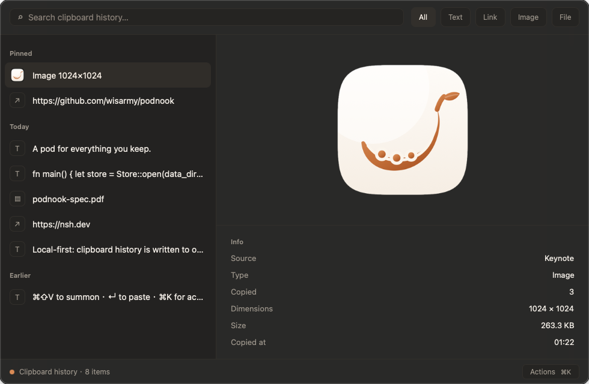

# Podnook

> A pod for everything you keep. / 把每件你在乎的事，都收进一只豆荚。

A local-first, open-source **clipboard history** for macOS. Everything you copy stays on your Mac: summon it with one hotkey, search, pin, and paste it back into any app. Nothing is uploaded.

Product context and decisions live in [`CONTEXT.md`](CONTEXT.md); architecture decisions in [`docs/adr/`](docs/adr/).

<p align="center">
  
</p>
<p align="center"><sub>Main panel · sample data</sub></p>

## Status

v0.2 (M4 packaged). What works today: menu-bar app without a Dock icon; a global
⌘⇧V hotkey opens a frameless panel (it covers other apps' full-screen spaces;
closes on blur or Esc); background clipboard capture (text / image / files /
links), de-duplication, privacy-marker filtering, SQLite persistence; search,
type filters, preview and metadata, pin, delete, and a **snippet library** (⌘2)
that keeps reusable text beside the history (⌘S saves a clip as a snippet);
Return pastes into the app you came from (⌘↵ only copies). The settings window (⌘, or the menu-bar menu) has
hotkey recording, retention, auto-paste, launch at login, ignored apps, history
clearing, permission status and the interface language. `make install` packages,
signs with a fixed identity and installs into `/Applications`.

The interface ships in English and Simplified Chinese; it follows the macOS
language and can be switched in Settings.

## Tech stack

- [Native Shell](https://nsh.dev) **v0.5.0** (pinned) + pure Rust, no TSX / QuickJS
- System layer: `NSPasteboard` polling, `CGEventPost` paste-back, `SMAppService` login item
- Storage: `rusqlite` (`history.db`) plus an image file cache
- Text: `locales/en.yml` and `locales/zh.yml` (rust-i18n format, loaded by NSH)

> ⚠️ NSH 0.5 is new and the documentation site still describes 0.4. **The repo docs at tag `v0.5.0` are authoritative**:
> `https://raw.githubusercontent.com/longbridge/nsh/v0.5.0/website/...`

## Requirements

- macOS 14+
- Rust (edition 2024)
- NSH CLI **v0.5.0**

Install the NSH CLI (**not Homebrew**, which only has v0.4.0). The v0.5.0 macOS CLI ships as an arm64 archive only; on an Intel Mac download the release archive instead:

```sh
curl -fsSL https://nsh.dev/install.sh | sh
# or the v0.5.0 archive:
# https://github.com/longbridge/nsh/releases/download/v0.5.0/nsh-macos-arm64.tar.gz
```

## Development

```sh
nsh run          # run the Rust app (incremental build + restart)
nsh check        # type/compile check
nsh test         # headless tests (including the Rust unit tests)
cargo test -p podnook-core   # domain and database tests, no NSH needed
./scripts/check-strings.py   # fail on UI text hard-coded in src/
```

> ⚠️ NSH debug builds are large: the first full build of `target/` is about 15 GB
> (dependencies compiled once per feature set). Run `cargo clean` when disk is
> tight; incremental builds afterwards stay small.

`PODNOOK_DATA_DIR` is for development only: it points the app at another data
directory (screenshots, manual QA). Unset, the app uses the standard directory
NSH assigns.

```sh
./scripts/seed-screenshots.py        # sample data into .nsh/screenshot-data
PODNOOK_DATA_DIR=.nsh/screenshot-data nsh run
make screenshot                      # regenerate docs/images/*.png
```

## Install

### Download

Get the DMG for your architecture from [GitHub Releases](https://github.com/wisarmy/podnook/releases):

- `Podnook-<version>-arm64.dmg`: Apple Silicon
- `Podnook-<version>-x86_64.dmg`: Intel Mac

Open the DMG and drag Podnook into Applications.

Release builds are signed with a fixed self-signed certificate, so updates do
not reset the Accessibility permission. They are not notarized by Apple, so the
first launch is stopped by Gatekeeper once:

1. Double-click the app; macOS says it cannot verify the developer;
2. Open **System Settings → Privacy & Security** and press **Open Anyway** under Security;
3. Or run: `xattr -dr com.apple.quarantine /Applications/Podnook.app`.

The first run also needs Accessibility permission from Settings (paste-back uses it).

### From source

```sh
make signing   # once: create the self-signed "Podnook Local Signing" certificate
make install   # package → re-sign with that identity → verify → install into /Applications → launch
```

`nsh package` only produces `.nsh/out/Podnook.app`, which is **not** an install;
`make install` replaces `/Applications/Podnook.app` and re-signs it.

Why the fixed identity: macOS binds the Accessibility permission to the app's
code signature. An ad-hoc signature's designated requirement is the binary's
cdhash, which changes on every build and drops the permission. A fixed
certificate's requirement is `identifier "com.podnook.app" and certificate leaf = H"…"`,
so rebuilds keep the permission.

Development uses `Podnook Local Signing`; GitHub releases use another fixed
self-signed certificate, `Podnook Release Signing`, whose files live only in
repository secrets. See [`docs/RELEASING.md`](docs/RELEASING.md).

Permission is granted once: Settings → “Accessibility” → “Request access” → turn
the switch on. Later `make install` updates do not ask again.

You need to grant it again only if the certificate is deleted or recreated, the
bundle id changes, or you switch machines (`tccutil reset Accessibility com.podnook.app`).

## Data and permissions

- Data directory: `~/Library/Application Support/com.podnook.app/`
  - `history.db`: clipboard history
  - `images/<hash>.png`: cached images
- By default only the system Passwords app is ignored. Add other sources in
  Settings with “Choose app…” (running apps) or by bundle id; metadata shows
  copy count and text size.
- **Accessibility**: used only for paste-back (it posts ⌘V). Without it the app
  falls back to copying only, and Settings offers “Request access”.
- No Dock icon: it lives in the menu bar. The default hotkey is **⌘⇧V**; the
  menu-bar icon opens the panel too. If another app's global hotkey already owns
  that combination, record a different one.
- Shortcuts (aligned with Raycast): `↵` paste, `⌘↵` copy only, `⌘K` actions,
  `⌘E` edit, `⇧⌘P` pin, `⌥⇧⌘S` save as file, `⌘P` cycle type filter, `⌃X`
  delete, `⇧⌘X` delete recent…, `⌃⇧X` clear all, `⌘O` open link/file, `⇧⌘O`
  reveal in Finder, `⌘,` settings, `Esc` close. `⌘1` shows the history and `⌘2`
  the snippets; in the history `⌘S` saves the selected clip as a snippet, and in
  the snippets `⌘S` creates one. Snippets understand `{date}`, `{time}` and
  `{datetime}`. `⌫` only edits the search field.
- Saving writes to `~/Downloads` by default; the path is editable in the actions
  panel. Text and links save as `.txt`, images as `.png`, file items copy the
  original file.

## Releasing

Versions are built by GitHub Actions: a `v*` tag produces arm64 and x86_64 DMGs
and a GitHub Release. Certificates, steps and Gatekeeper notes are in
[`docs/RELEASING.md`](docs/RELEASING.md).

## License

See [`LICENSE`](LICENSE).

---

# 中文

本地优先、开源的 macOS **剪贴板历史**工具。复制过的一切留在本机，一个快捷键召回、搜索、粘回，绝不上传。

界面跟随系统语言，可在设置 →「语言」里切换。

## 安装

### 下载

从 [GitHub Releases](https://github.com/wisarmy/podnook/releases) 下载对应架构的 DMG：

- `Podnook-<version>-arm64.dmg`：Apple Silicon
- `Podnook-<version>-x86_64.dmg`：Intel Mac

打开 DMG，把 Podnook 拖进 Applications。

发布包用固定的自签名证书签名，后续更新不会重置辅助功能权限；但未经过 Apple
公证，**首次打开会被 Gatekeeper 拦一次**：系统设置 → 隐私与安全性 → 仍要打开，
或执行 `xattr -dr com.apple.quarantine /Applications/Podnook.app`。

### 从源码安装

```sh
make signing   # 一次性：在本机钥匙串创建自签名证书 Podnook Local Signing
make install   # 打包 → 用固定身份重签 → 校验 → 安装到 /Applications → 启动
```

首次使用只需授权一次：设置 → 「辅助功能」→「请求权限」→ 在系统设置里打开开关。

## 数据与权限

- 数据目录：`~/Library/Application Support/com.podnook.app/`（`history.db` 与 `images/`）。
- 默认只忽略系统「密码」App；其它来源可在设置里点「选择 App…」添加，或手动填 bundle id。
- 辅助功能权限仅用于「粘回」（模拟 ⌘V）；未授权时自动降级为「仅复制」。
- 应用无 Dock 图标，常驻菜单栏；默认热键 **⌘⇧V**（可在设置里录制修改）。

快捷键：`↵` 粘贴、`⌘↵` 仅复制、`⌘K` 操作面板、`⌘E` 编辑内容、`⇧⌘P` 固定、
`⌥⇧⌘S` 保存为文件、`⌘P` 切换类型筛选、`⌃X` 删除、`⇧⌘X` 删除最近…、
`⌃⇧X` 清空全部、`⌘O` 打开链接/文件、`⇧⌘O` 在 Finder 中显示、`⌘,` 设置、`Esc` 收起。
`⌘1` 是历史、`⌘2` 是片段；历史里 `⌘S` 把选中条目存成片段，片段里 `⌘S` 新建。
片段支持 `{date}`、`{time}`、`{datetime}` 占位符。

片段库（v0.3）：把常用文本存下来，用 `⌘2` 切换、搜索后回车粘贴；不监听全局键盘，
也不新增权限。

## 开发

```sh
nsh run          # 运行 Rust 应用（增量编译 + 重启）
nsh check        # 类型/编译检查
nsh test         # headless 测试（含 Rust 单测）
cargo test -p podnook-core   # 领域层与数据库单测，不依赖 NSH
```

界面文案在 `locales/en.yml` 与 `locales/zh.yml`；`src/` 里不允许出现中文界面文本，
`./scripts/check-strings.py` 会检查。
